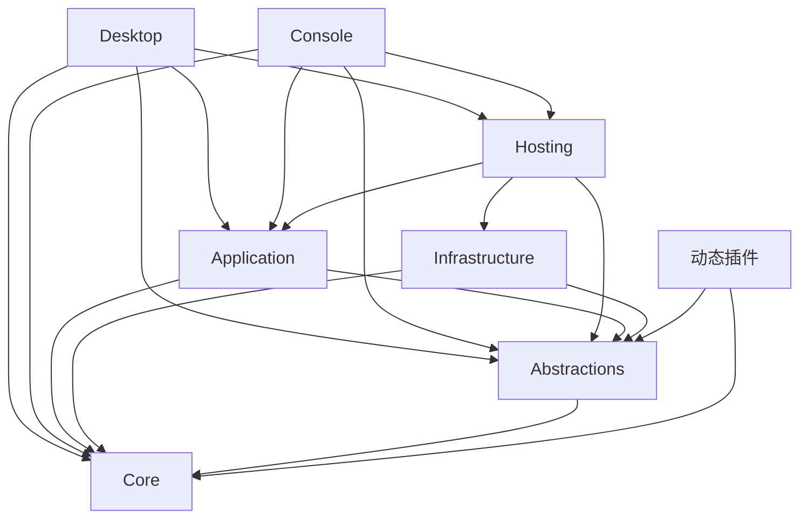

# LemonNeo 项目与模块结构

实施日期：2026-10-06。以 `070095e` 为迁移基线，五个阶段已实施，`src/` 从 11 个项目收敛为 7 个项目，直接项目引用从 33 条收敛为 16 条。

项目仍处于 private 状态，没有历史插件二进制需要支持。插件契约、领域模型、命名空间与随附插件一起迁移并重建，不保留旧程序集身份、类型转发或兼容适配层。

## 项目依赖

| 项目 | 职责 | 当前直接项目引用 |
| --- | --- | --- |
| LemonNeo.Core | 纯音乐、Library、播放与歌词模型，异常和音乐缓存标识工具 | 无 |
| LemonNeo.Abstractions | 插件入口、提供者与播放器能力、配置和存储契约 | Core |
| LemonNeo.Application | Library、搜索、元数据、播放、歌词及三个独立 Cache | Core、Abstractions |
| LemonNeo.Infrastructure | 配置存储、路径、凭据保护、JSON Library 仓储和插件加载 | Core、Abstractions |
| LemonNeo.Hosting | 公共装配与初始化、关闭生命周期 | Application、Infrastructure、Abstractions |
| LemonNeo.Desktop | Avalonia 界面、绘制、图片解码、主题、本地化与桌面宿主 | Hosting、Application、Abstractions、Core |
| LemonNeo.Console | 命令与补全、输入、历史、启动脚本、终端歌词和兜底播放器 | Hosting、Application、Abstractions、Core |



Application 与 Infrastructure 互不引用；宿主不引用 Infrastructure 或具体插件；共享项目不引用宿主；动态插件只引用 Core、Abstractions，以及自身需要的外部库。直接使用哪个程序集的类型，就声明对应项目引用。

Infrastructure 的实现类型全部为 internal，仅向 Hosting 开放内部访问。这使宿主无法通过 SDK 的传递引用直接调用实现。宿主通过 `IPluginDiagnostics` 读取插件清单、交互类型、注册 ID 与加载失败，通过 `IAppPathProvider` 访问路径；默认路径由 `AppHost.CreateDefaultPaths()` 创建。

Core 无第三方框架依赖。其余项目按实际使用声明日志、HTTP、内存缓存、DI 和 DataProtection 包，不再引用 `Microsoft.AspNetCore.App` 框架。

## 模块与类型归属

```text
src/
  LemonNeo.Core/
    Music/                 Track、Artist、Album、音乐 ID、MusicCacheIdentity
    Library/               MusicLibrary、Playlist、PlaylistItem、Mirror
    Playback/              PlaybackSource、PlaybackRequest、公共播放值
    Lyrics/                Lyrics、LyricsLine、LyricsWord、罗马音模型
    Exceptions/
  LemonNeo.Abstractions/
    Plugins/               生命周期、上下文、诊断 DTO、InteractivePluginBase
    Providers/             搜索、查询、导入、播放源、歌词、元数据、认证
    Playback/              Player、下载 sink、外部控制
    Settings/              配置服务、包作用域、实体存储端口
    Storage/               Library 仓储、路径、凭据端口
  LemonNeo.Application/
    Library/               Library、歌单、排序、导入
    Providers/             搜索、查询、元数据
    Playback/              队列、解析、会话、交互、恢复状态
    Lyrics/                歌词获取、文档、时间轴
    ImageCache.cs
    LyricsCache.cs
    PlaybackAudioCache.cs
  LemonNeo.Infrastructure/
    Paths/
    Settings/
    Credentials/
    Library/
    Plugins/
  LemonNeo.Hosting/
    AppHost.cs
    HostOptions.cs
    Registration/
  LemonNeo.Desktop/
    DesktopHost.cs          桌面宿主装配
    DesktopContext.cs       共享运行上下文
    Services/              图片、主题、本地化与导航服务
    Utils/                 取色与调色板计算
    Config/                桌面存储选项、配置实体与注册校验
    Platform/              桌面歌词平台行为
    Controls/              Shared、Lyrics、Navigation
    ViewModels/            Shared 与各功能模块
    Views/                 Shared 与对应功能模块
    Resources/             主题与语言资源
  LemonNeo.Console/
    Commands/
    Input/
    Lyrics/
    Playback/
    Startup/
```

共享模块使用与目录一致的命名空间，例如 `LemonNeo.Core.Lyrics`、`LemonNeo.Abstractions.Plugins`、`LemonNeo.Application.Playback`。Console 内部按功能分类目录，沿用宿主命名空间 `LemonNeo.ConsoleApp`。

Desktop 目录迁移也使用与目录一致的命名空间，具体文件归属及验证记录见 [Desktop 目录迁移方案](desktop-structure-migration-plan.md)。

| 类型 | 归属与边界 |
| --- | --- |
| ILibraryRepository | Abstractions.Storage；JSON 实现位于 Infrastructure.Library |
| IPlaylistOrderingService | Application.Library 内的歌单排序策略 |
| IPlaybackQueue、PlaybackQueue | Application.Playback，与队列恢复状态共同组织 |
| PlaybackQueueState、PlaybackResumeState、PlaybackPreferences | Application.Playback；配置仍使用 Application 包 |
| IPlayer、IPlaybackDownloadSink、IPlaybackInteraction | Abstractions.Playback，供宿主与插件共用 |
| Lyrics 等歌词模型 | Core.Lyrics；歌词组织和时间轴属于 Application.Lyrics |
| InteractivePluginBase | Abstractions.Plugins，插件无需引用 Infrastructure |
| PluginLoader、加载上下文、注册表 | Infrastructure.Plugins 的内部实现；诊断报告不持有插件实例或加载上下文 |
| StartupCommands、StartupPreferences、ConsolePlayer | 仅属于 Console，不在 Hosting 或 Desktop 登记 |
| ArtworkService、主题、桌面歌词平台 | 仅属于 Desktop |

三个 Cache 保持独立单文件、具体类调用和原有 API，不新增接口、不拆分文件或引入缓存适配层。ImageCache、LyricsCache 留在 Application 根目录；PlaybackAudioCache 随 Playback 项目合并进入同一目录。LyricsCache 继续使用 LyricsLookupResult；MusicCacheIdentity 的 ID 规范化、去重和缓存 key 算法完整保留。

`Get<T>()` 保留为应用服务与宿主服务的解析入口；具体基础设施访问已移除。Console 命令通过构造参数注入所需服务，无需为每个应用服务新增接口。

## 插件构建

```powershell
dotnet run --project src/LemonNeo.Console -- --library C:\Music\LemonLibrary
```

默认插件列表仅维护在 `build/LemonNeo.Plugins.props`，包括平台条件。共享 `build/LemonNeo.Plugins.targets` 负责两宿主构建、显式部署和发布，复制 manifest、托管依赖和原生目录。

- 宿主通过 `IsLemonNeoHost` 启用规则，插件列表不是 ProjectReference。
- 单独构建插件只生成自己的输出，宿主构建通过 `PluginDeploymentRoot` 指定部署目录。
- `SkipHostPlugins=true` 可在构建和测试时跳过默认插件构建。
- Console 与 Desktop 发布均包含默认插件及资源。
- macOS 的原生 helper 构建仍由 MacNowPlaying 项目按平台执行。

## 迁移阶段

| 阶段 | 已实施内容 |
| --- | --- |
| 1. 引用与归属 | 清理宿主和共享层的具体插件引用；补齐直接引用；建立功能目录 |
| 2. 宿主边界 | 增加插件诊断契约；路径实现经 Hosting 创建；宿主脱离加载器 |
| 3. 实现项目合并 | Configuration、Persistence、Plugin.Runtime 合并为 Infrastructure |
| 4. 业务与契约整合 | Playback 并入 Application；两套契约合并为 Abstractions；统一插件构建与发布 |
| 5. API 与命名 | 基础设施实现设为 internal；直接迁移全部共享命名空间、歌词模型、插件实现和加载器共享程序集名单 |

撤销的项目文件和解决方案条目已移除。原共享程序集名单已更新为 `LemonNeo.Core`、`LemonNeo.Abstractions` 和 `Microsoft.Extensions.*`，随附插件全部使用新契约。

## 持久化与验证

结构迁移保持 PackageNames.Application/Desktop/Console、插件 manifest ID、Provider ID、配置实体名、JSON 字段、Library 路径、缓存目录与凭据用途字符串不变。凭据的 DataProtection 应用名与保护器用途沿用现状。

Hosting 的关闭顺序仍为：停止配置循环、捕获播放状态、关闭插件、保存 Library、保存配置、释放服务与插件配置、卸载插件上下文。插件的关闭修改在释放配置前保存。

```powershell
dotnet build LemonNeo.slnx --disable-build-servers -m:1
dotnet publish src/LemonNeo.Console -c Release -o artifacts/publish/console --disable-build-servers -m:1
dotnet publish src/LemonNeo.Desktop -c Release -o artifacts/publish/desktop --disable-build-servers -m:1
```

静态检查实际编译程序集引用和 Infrastructure 的公开类型，验证项目依赖方向，防止通过传递引用绕过约束。

Windows 验证包括随附插件的托管编译、两宿主发布与 Console 启动检查；macOS 原生 helper 的编译和系统交互需要在 macOS 上验证。

当前验收要求为完整解决方案构建零警告、零错误；两个宿主发布均包含平台默认插件及其原生资源，没有旧项目程序集。

现有多进程配置写入、插件热替换等后续问题见 [持久化重构后续问题](persistence-follow-ups.md)，没有在本次结构迁移中改变相关语义。新增功能优先进入已有模块目录；出现独立发布、外部 API 或平台部署边界时再评估新增项目。
